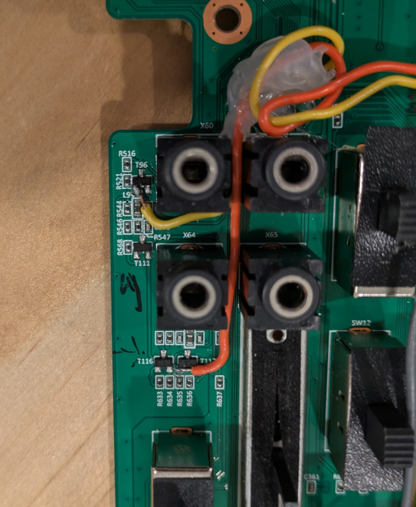

# Beholder's mods of Behringer 2600

## References

* [Maffez Synth Mods 2600](https://maffez.com/?page_id=1473) - experimental modding guide to Barp 2600 most of my modes are implementations of ideas in that doc. Kudos!
* [Creative Inquiry ARP 2600](https://github.com/CreativeInquiry/ARP-2600) - Lot of information about original including two different service manuals.

## Things to consider before mods

* Behringer 2600 is tiny smt so skills, multimeter, proper soldering iron, hot glue gun etc are must.
* My Step by step process:
    1. Measure wire lengths so wires are sitting nicely.
    1. It's important to predict where switches/sockets would be located before soldering.
    1. Clean ends of wires so they are ready to solder.
    1. Bent wires, then adjust so they are laying flat on surface.
    1. Use hot glue to attach them to board approx in middle. Don't put glue on the parts.
    1. Solder wires to original parts/contacts
    1. Solder opposite side of wires to socket/switch/resisters/etc
    1. Drill panel

I use [right angle mono jacks from Synthrotek](https://store.synthrotek.com/3_point_5mm_angle_mono_audio_jack)
because they are fitting nicely between panel and board, basically they are about hight of metalic stands/og
socket shoulders.

## Description of mods

### Master 5v Gate

There are several ways how to control Gate and Trig on 2600:

1. VIA Gate/Trig sockets (when switch under AR Gate label is up). They are working with standard 5v, but AR (~lag generator) is not charged enough. Requires additional 1 in 2 outs cable. One can see difference between manual trig and 5v.
1. VIA S/H Clock break in. Works with regular cable. Has the same problem of 5v is not enough.
1. VIA Midi. Ok on Gearspace, bannable offence on Modwiggler.

It's possible to tap between CPU and base of triggering transistor (NPN, 468). That gate is usual CPU -> NPN -> PNP -> LOAD.

### Master CV

If you're using eurorack CV hardware for sequencing this mod is must have.
The way gate mod described by Maffez is a bit hard to understand so here be dragons.
