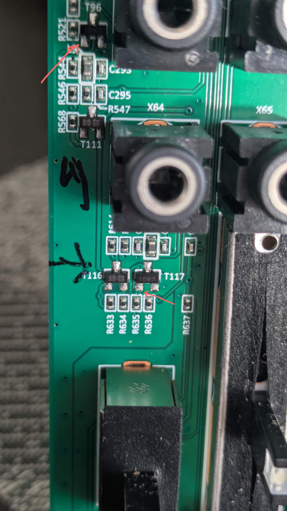
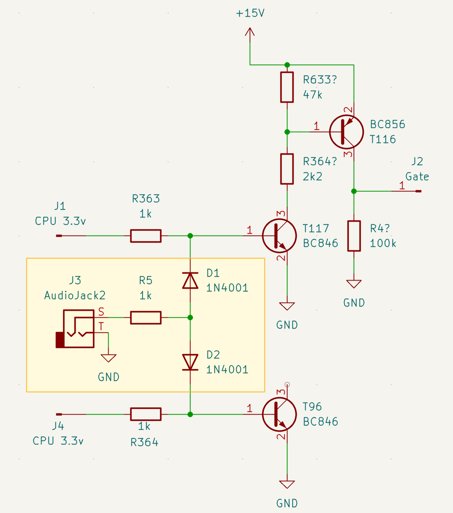
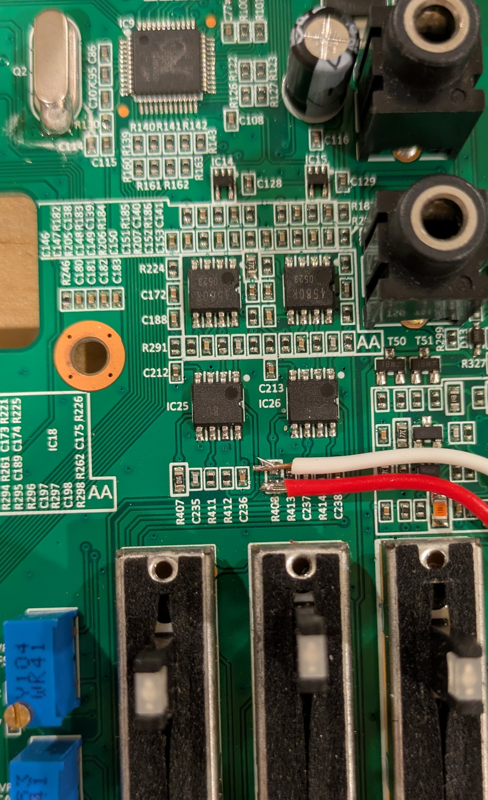

# Beholder's mods of Behringer 2600

## References

* [Maffez Synth Mods 2600](https://maffez.com/?page_id=1473) - experimental guide to Barp 2600 modding. Most of my modes are implementations of ideas from that doc. Please read it first.
* [Creative Inquiry ARP 2600](https://github.com/CreativeInquiry/ARP-2600) - Lot of information about original including two different service manuals.

## Things to consider before mods

* Behringer 2600 is tiny smt so skills, multimeter, proper soldering iron, hot glue gun etc are must.
* My Step by step process:
    1. Measure wire lengths so wires are sitting nicely.
    1. It's important to predict where switches/sockets would be located before soldering.
    1. Clean ends of wires so they are ready to solder.
    1. Bent wires, then adjust so they are laying flat on surface.
    1. Use hot glue to attach them to board approx in middle. Don't put glue on the parts.
    1. Solder wires to original parts/contacts
    1. Solder opposite side of wires to socket/switch/resisters/etc
    1. Drill panel

I use [right angle mono jack socket from Synthrotek](https://store.synthrotek.com/3_point_5mm_angle_mono_audio_jack)
because they are fitting nicely between panel and board, basically they are about haight of metallic stands/behringer's
socket shoulders.

## Description of mods

### Master 5v Gate

There are several ways how to control Gate and Trig on Barp 2600:

1. VIA Gate/Trig sockets (when switch under AR Gate label is up). They are working with standard 5v, but AR (~lag generator) is not charged enough. Requires additional 1 in 2 outs cable. One can see difference between manual trig and 5v.
1. VIA S/H Clock break in. Works with regular cable. Has the same problem of 5v is not enough.
1. VIA Midi. Ok on Gearspace, bannable offense on Modwiggler.

Mod is to tap between CPU and base of triggering transistor (NPN, 468). That gate is usual CPU -> NPN -> PNP -> LOAD.

Requires:
1. Socket
1. ~~2k2~~ 1k5
1. 2 x 4001 diodes

### Master CV

There are two ways how to control CV on Barp:

1. Via CV sockets. Requires at max 1 in 4 out cable (uff): OSC1-3 and Filter.
2. Via Midi. Actually it's allowed on MW because of Portamento and Pitch Bend support. Search for "Behringer 2600 pitch bend range sysex".

Schematics is like: CPU CV out -> R408 (R100) -> buffer -> CVs

Mod is well described in Maffez guide, it requires normalized socket i.e. one that has Tip - Norm connection if there is no jack in socket.
1. Remove R100
1. Solder wires to top / bottom terminals
    1. Top terminal -> R100 -> Norm
    2. Bottom terminal -> Tip
1. Ring goes to ground

Requires:
1. Normalized socket
1. R100

### Filter Input Boost/Drive

Switch with R50k-100k (I'm thinking R74k) in parallel to R191

Requires:
1. Switch
1. R74k

### Pre-Filter Sum output

Useful for summation with Filter Output in order to create HP/BP.
Connect pin 1 of IC 20 (output of LM4580 ch 1) to 1uf (-> 470k gnd) -> Tip, Ring -> Ground.

1. Socket
2. 1uf cap
3. 470k

### Filter 6db, 12db taps

I need to study more but differential pair is nice with opamp

(- C -) -> 1uf 100k gnd -> (-) TL072 (+- 15v) -> (FB 100k -> (-)) -> 1k -> socket
(- C -) -> 1uf 100k gnd -> (100k -> gnd) -> (+) TL072

Requires(Per Tap):
1. Socket
1. 2 x 1uf
1. 4 x 100k
1. 1 x 1k
1. TL072

### VCA Input Boost/Drive

VCA in1 is R447 100k. VCA in2 is R448 also 100k. DPDT with two 150k resisters would make it.

Requires:
1. DPDT
1. 2x150k

### Buffered mult

B2600 mult is unbuffered. One can do it with stacking cables. One TL072 could serve two batches of multiples. My plan is to convert current into buffered and add one more 1 in 2 out buffered mult.

### Attenuated CV VCA

One of the things 2600 is lacking is ka*b like signal processing aka controlled vca. TL072, LM1370 or LM3080 and 2N3906. There are plenty examples like:
* [https://elecschem.com/lm13700-vca-schematic]
* [https://github.com/benjiaomodular/MiniVCA]
* [https://electricdruid.net/design-a-eurorack-vintage-vca-with-the-lm13700/]
* [https://www.geocities.ws/dhar2kma/vca.htm]
* [https://www.reddit.com/r/modular/comments/wrwzlg/comment/ikymabz/]

Main Inp, CV Inp + Knob => Output

## Considerations

### Effect Send/Return

I'm still thinking how to do it better.
My idea is to use mixer out as send, then reuse reverb out socket + additional socket as return and route them thru sliders. This way one can use slider to control mixing in amount. Would it make sense to add knob for attenuating send?

### LFO Reset/Syn

It would be nice to at least reset lfo based on tempo but some of eurorack sequencers are supporting lfos

### Env 3

AR and ADSR is not enough, altho it's easier to solve with external eurorack

### Two filters simoultaneously

I like 4012 way more than 4072. In theory it's possible to rewire resonance chain for 4072 and for complete separation.
This mod may be big as it requires Reso chan + pot, CV offset pot, separate output

### Mutimode filter

It's nice to have something like [https://github.com/kassu/kassutronics/blob/master/documentation/KS-20%20VCF/Kassutronics_KS-20_Build_Docs_1.1B.pdf]
But it's more realistic to do something with 4072 like rewire resonance and invert against input

## Secrets and Hacks

### Highpass / Bandpass

Dragons
